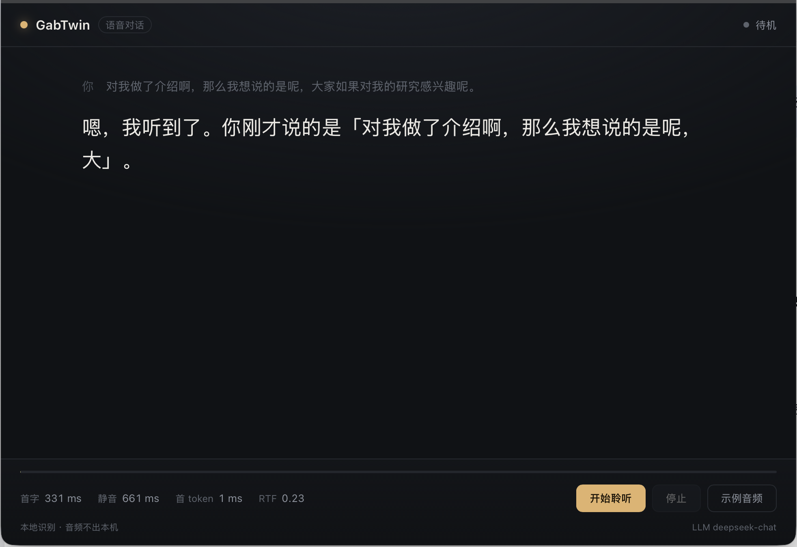

# dev/03 · LLM 接话（文字流式回复）

> 状态：**已跑通**（2026-10-26）。本地 mock 验证了完整链路；真实 DeepSeek key 的
> 首 token 数字待你用真 key 测一次。

## 目标

识别定稿之后，让模型**马上**接一句话：先把字流出来，不做"转圈等全文"。
TTS 与数字人是下一步，这一片只做文字。

## 流程

```text
麦克风 → 流式字幕（paraformer）
            │
            └─ 句末定稿（SenseVoice，带标点）
                    │  Segment 事件
                    ▼
              对话上下文（system + 最近 N 条）
                    │
                    ▼
              POST /chat/completions（stream=true）
                    │  SSE delta
                    ▼
              UI 逐字追加（llm-delta）
                    │
                    ▼
              llm-done（首 token / 总耗时）
```

## 关键决定

| 问题 | 做法 | 原因 |
|---|---|---|
| 什么时候发 | **句末定稿后**，不是 partial | partial 还会改，发出去会浪费且回复对不上 |
| 怎么等 | **SSE 流式**，来一个字显示一个字 | 首 token 通常 300–600 ms，比等全文快得多 |
| 用户又说了一句 | **取消上一轮**（turn_id + 取消旗标） | 新语音优先；旧 delta 到 UI 后被 turn_id 丢弃 |
| 上下文 | system + 最近 12 条、≤4000 字 | 足够闲聊，避免长上下文拖首 token |
| 口语化 | system prompt 强制短句、无 Markdown、无列表 | 后面要接 TTS，书面格式会被念出来 |
| 没有 key | 只显示识别结果，并把原因显示出来 | 不静默失败 |
| 错误 | 401/超时/空回复都进 `llm-error` | 用户可以看见，不会以为"它不理我" |

## 配置

```bash
export DEEPSEEK_API_KEY=sk-...          # 或 GABTWIN_LLM_KEY
export GABTWIN_LLM_BASE=https://api.deepseek.com   # 默认
export GABTWIN_LLM_MODEL=deepseek-chat             # 默认
./scripts/gabtwin-start.sh
```

没有 key 也能跑识别；右下角会写"未配置 LLM key"。

## 事件

| 事件 | 载荷 | 说明 |
|---|---|---|
| `llm-thinking` | `turn_id` | 已发起，等待首 token |
| `llm-delta` | `turn_id`, `text` | 增量文本 |
| `llm-done` | `turn_id`, `text`, `first_token_ms`, `total_ms` | 完成 |
| `llm-cancelled` | `turn_id` | 被新语音或停止取消 |
| `llm-error` | `turn_id`, `message` | 失败原因 |

## 不用真 key 也能验证链路

```bash
python3 scripts/mock-llm.py &        # 本地 SSE，回显你这句话
DEEPSEEK_API_KEY=dummy GABTWIN_LLM_BASE=http://127.0.0.1:8787/v1 \
  ./scripts/gabtwin-start.sh
```



## 延迟预算（到首 token）

| 阶段 | 实测/预期 |
|---|---|
| 句末定稿（SenseVoice） | 约 200–400 ms |
| 请求 + 首 token（DeepSeek） | 预期 300–600 ms（待真 key 实测） |
| **合计** | **约 0.5–1.0 s** |

UI 的"首 token"读数就是这一段；mock 下是 1 ms，不要拿它当真实网络数字。

## 已知限制

1. **没有持久化**：重启应用对话历史清零；也没有"记忆"。
2. **只有一个默认人设**；3 个角色还没接（等 TTS 音色）。
3. **key 在环境变量里**，还没进 Keychain。
4. 没有重试与限流；DeepSeek 偶发 429 会直接显示错误。
5. 没有内容安全过滤；自用可接受，对外要先补。
6. 用户在一句话里停顿会被切成两轮（端点 0.8 s 决定），模型可能把半句当完整问题。

## 下一步

- [ ] TTS：把回复按句切分、逐句合成、边合成边播（首句 ≤10 字）
- [ ] 3 个角色：人设文件 + 各自音色
- [ ] key 进 Keychain，设置页可填
- [ ] 429/超时重试一次；失败时说一句固定话术
- [ ] 上下文摘要（长对话）
